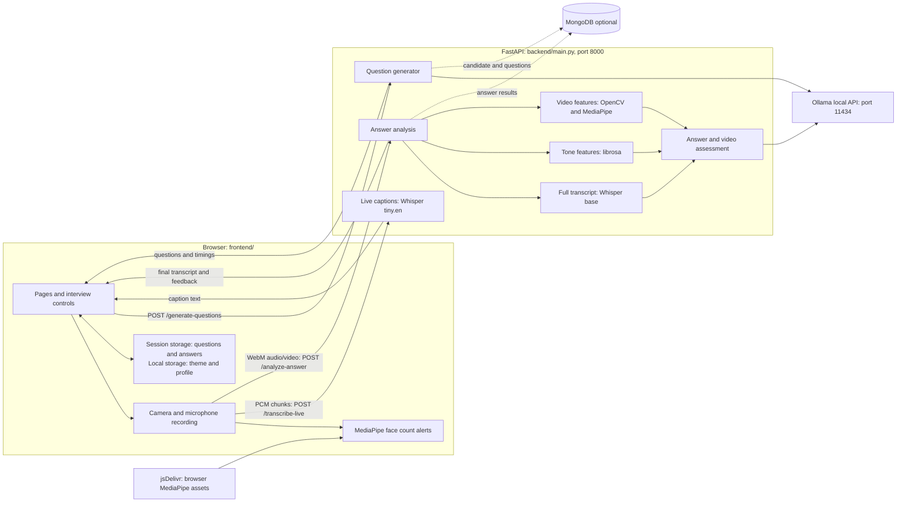

# AI-Powered Interview Model

A local browser app that generates three interview questions from a candidate's background and job description, records spoken answers, displays live captions, and produces a report. Ollama handles question generation and AI assessment; Whisper runs transcription on the backend.

## Features

- **Three tailored questions:** Generated at registration, then kept in the browser for the interview.
- **Live captions:** Roughly five-second microphone chunks go to Whisper tiny.en. A full-answer Whisper base transcript replaces provisional captions when analysis completes.
- **Background analysis:** The next question starts after the recording is saved. The report waits for all pending answer analysis.
- **Feedback:** Librosa extracts audio features; Ollama scores answers and assesses recorded-video metrics. Rule-based scoring is used if Ollama assessment fails.
- **Camera alerts:** Browser MediaPipe Face Detection warns when no face or multiple faces are visible during recording. This is separate from backend video assessment.
- **Light and dark themes:** The theme preference is saved in browser storage.

## Architecture

### Request flow

1. **Registration:** The browser posts candidate details to /generate-questions. The backend asks Ollama for three questions and answer-time estimates. Registration waits for this result. If Ollama fails, the backend has fallback questions, but the registration page shows an error rather than starting a fallback interview.
2. **Interview:** The browser reads the questions and timings from sessionStorage, speaks each question with browser speech synthesis, then records WebM audio and video. Browser MediaPipe checks the camera for face-count alerts.
3. **Captions:** During recording, an AudioWorklet (or ScriptProcessor fallback) sends about five seconds of PCM audio per request to /transcribe-live. Captions appear after each chunk is processed, so they are not a word-by-word stream.
4. **Answer analysis:** When recording stops, the browser posts the WebM files to /analyze-answer and moves to the next question. The backend runs full transcription, tone analysis, answer scoring, and video analysis. The final transcript replaces provisional captions. Temporary uploaded files are removed after processing.
5. **Report:** After question three, the interview page waits for pending analysis, saves results in sessionStorage, and opens report.html. MongoDB can also persist candidate and answer data; the app runs without it.

## Setup on Windows (PowerShell)

### Prerequisites

- Python with venv and pip. Backend packages are listed in [backend/requirements.txt](backend/requirements.txt).
- [FFmpeg](https://ffmpeg.org/download.html) installed on PATH. Verify with ffmpeg -version; Whisper needs it to read WebM recordings.
- [Ollama](https://ollama.com/) installed and running locally, with enough memory to load the chosen model. CPU inference can be slow.
- A current browser supporting camera, microphone, MediaRecorder, and Web Audio. Allow camera and microphone access for the local site.
- Internet access for browser MediaPipe assets from jsDelivr and Google Fonts. Ollama and Whisper inference runs locally. The first backend startup may download Whisper model weights.
- MongoDB is optional. Without it, backend candidate questions remain in memory and interview results remain in browser storage for the session.

### 1. Prepare Ollama

In PowerShell, download the default model:

~~~powershell
ollama pull llama3.1:8b
ollama list
~~~

Make sure the Ollama application or service is running. If it is not already running, use ollama serve in a separate terminal. The backend connects to http://localhost:11434 by default.

### 2. Install Python dependencies

From the project root (the folder containing this README):

~~~powershell
python -m venv venv
.\venv\Scripts\Activate.ps1
python -m pip install -r backend\requirements.txt
ffmpeg -version
~~~

If PowerShell blocks activation, run the install command with .\venv\Scripts\python.exe from the project root, and run main.py with ..\venv\Scripts\python.exe after entering backend/. The backend loads Whisper base and tiny.en at startup; their first run can take longer while model files download.

### 3. Start the backend

In the same terminal, from the project root:

~~~powershell
Set-Location backend
python main.py
~~~

Keep this terminal open. Visit http://127.0.0.1:8000 to check for a healthy status. Start from backend/ because main.py imports sibling modules and uses paths relative to that folder.

### 4. Start the frontend

Open a second PowerShell terminal in the project root:

~~~powershell
python -m http.server 3000 --bind 127.0.0.1 --directory frontend
~~~

Open http://127.0.0.1:3000/ in the browser. Register, grant camera and microphone access, and start the interview. Keep both server terminals open until the report appears.

## Configuration

Set overrides in the **backend terminal before** starting main.py. For example:

~~~powershell
$env:OLLAMA_MODEL = "llama3.1:8b"
$env:OLLAMA_QUESTION_TIMEOUT = "180"
~~~

| Variable | Default | Purpose |
| --- | --- | --- |
| OLLAMA_API_BASE | http://localhost:11434 | Ollama API address |
| OLLAMA_MODEL | llama3.1:8b | Answer and video assessment model; also questions unless overridden |
| OLLAMA_QUESTION_MODEL | Same as OLLAMA_MODEL | Optional separate question model; download it with Ollama first |
| OLLAMA_QUESTION_TIMEOUT | 180 seconds | Maximum wait for question generation |
| OLLAMA_SCORING_TIMEOUT | 240 seconds | Maximum wait for answer scoring |
| OLLAMA_VIDEO_TIMEOUT | 240 seconds | Maximum wait for video assessment |
| WHISPER_LIVE_MODEL | tiny.en | Live caption model; final transcription uses base |
| MONGODB_URI | mongodb://localhost:27017 | Optional MongoDB address |
| MONGODB_DB | ai_interview | MongoDB database name |

The frontend uses http://127.0.0.1:8000 in [frontend/register.html](frontend/register.html) and [frontend/script.js](frontend/script.js). If the backend port changes, update both URLs before serving the frontend.

## Troubleshooting

| Symptom | Check |
| --- | --- |
| Registration stays on Generating Questions or reports an Ollama error | Confirm ollama list shows the configured model and Ollama is running. Read the backend log for timeouts or unusable model output. A cold CPU model can take longer. |
| Captions are late or missing | Confirm microphone permission and that the backend is running. Captions arrive after each chunk is transcribed. Check browser console and backend logs for /transcribe-live errors. |
| Scoring says rule_based_fallback | The Ollama scoring request failed or returned unusable data. Check the backend log and scoring_error in the response, then verify Ollama and the installed model. |
| Face monitoring is unavailable | Check browser camera permission and access to the pinned MediaPipe files on jsDelivr. Browser alerts are independent of backend video analysis. |
| Backend video_analysis contains an error about mediapipe.solutions | The recorded-video analyzer currently uses MediaPipe's legacy solutions API. Some installed MediaPipe versions do not expose it; browser face-count alerts use separate browser assets and can still work. |
| Backend reports ffmpeg not found | Install FFmpeg, reopen the terminal, and confirm ffmpeg -version works. |
| Backend fails to bind with WinError 10013 | Check whether port 8000 is occupied or reserved. Stop any duplicate backend, or choose another port and update both frontend backend URLs. |
| Report takes time after the last answer | It waits for pending full transcripts and assessments. Whisper, video processing, and Ollama calls can take several minutes on a CPU. Keep the tab open until it redirects. |

## Project layout

| Path | Role |
| --- | --- |
| [frontend/](frontend/) | Pages, styles, theme, recording, captions, camera alerts, report |
| [backend/main.py](backend/main.py) | FastAPI routes and answer pipeline |
| [backend/question_generator.py](backend/question_generator.py) | Ollama questions and timing estimates |
| [backend/interview_scorer.py](backend/interview_scorer.py) | Answer scoring and rule-based fallback |
| [backend/video_analyzer.py](backend/video_analyzer.py) | Recorded-video features and assessment |
| [backend/mongo_store.py](backend/mongo_store.py) | Optional MongoDB persistence |
| [tests/](tests/) | Python and JavaScript tests |
